

  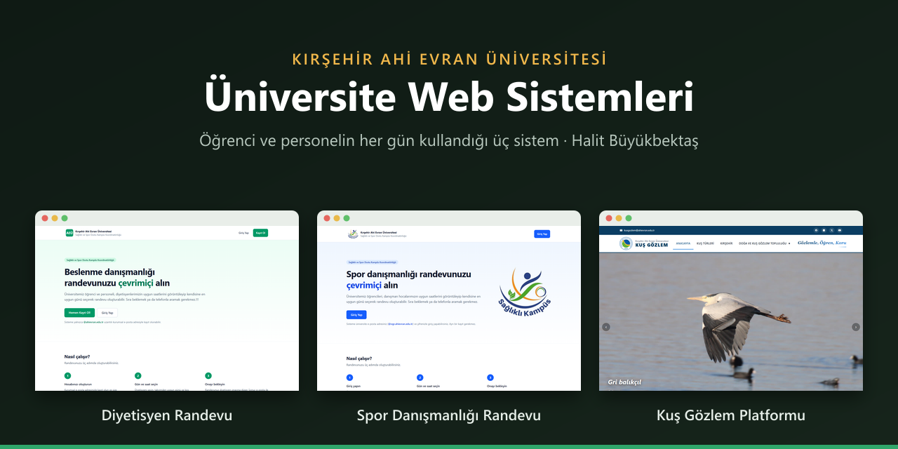

<h1 align="center">Üniversite Web Sistemleri</h1>

  Kırşehir Ahi Evran Üniversitesi için tasarlayıp geliştirdiğim, üniversite sunucularında yayında olan üç web sistemi.

  
  
  

> [!NOTE]
> Bu depo projelerin tanıtımıdır. Sistemler kurum için geliştirildiğinden kaynak kodları gizli depolarda tutulur.

## Projeler

| | Proje | Ne işe yarar | Teknoloji |
|:-:|---|---|---|
| 🥗 | [**Diyetisyen Randevu Sistemi**](#-diyetisyen-randevu-sistemi) | Öğrenci ve personel diyetisyenlerden çevrimiçi randevu alır | Laravel 12 · Filament 3 · Livewire 3 · MySQL |
| 🏃 | [**Spor Danışmanlığı Randevu Sistemi**](#-spor-danışmanlığı-randevu-sistemi) | Öğrenciler danışman hocalardan çevrimiçi randevu alır | Laravel 12 · Filament 3 · Livewire 3 · MySQL |
| 🐦 | [**Kuş Gözlem Platformu**](#-kuş-gözlem-platformu) | Hirfanlı Baraj Gölü'ndeki kuş türlerini QR kodla tanıtır | Node.js · Express 5 · MySQL |

---

## 🥗 Diyetisyen Randevu Sistemi

**Sağlıklı ve Spor Dostu Kampüs Koordinatörlüğü** · 🔗 [diyetisyen.ahievran.edu.tr](https://diyetisyen.ahievran.edu.tr)

Beslenme danışmanlığı randevuları telefonla ya da birime gidilerek alınıyordu; danışan boş saatleri
bilmiyor, diyetisyen programını elle tutuyordu. Bu sistemde danışan boş saati takvimden seçiyor,
diyetisyen talepleri tek ekrandan onaylıyor ve herkes e-postayla bilgilendiriliyor.

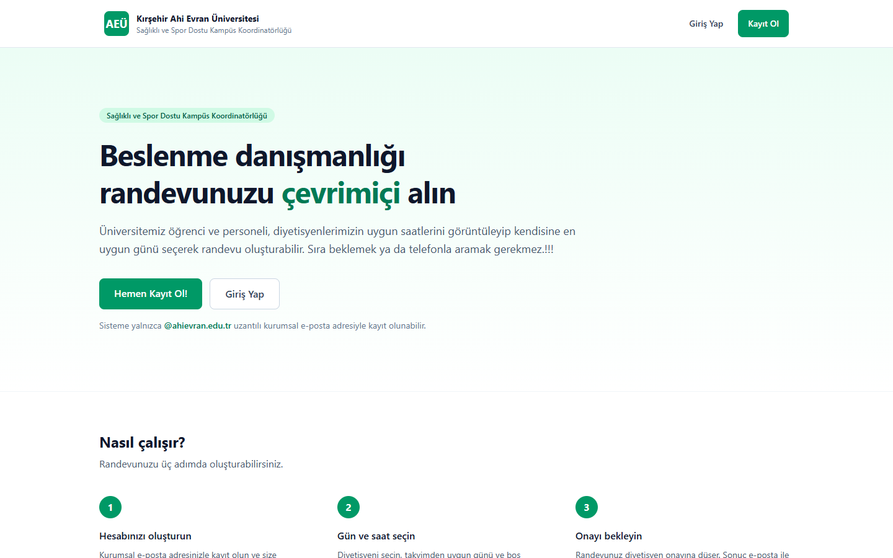

**Danışan tarafı**
- Yalnızca `@ahievran.edu.tr` uzantılı kurumsal e-posta ile kayıt ve giriş
- Boş saatleri anlık gösteren takvim; aynı saate iki randevu alınamaz
- Geçmiş ve gelecek randevuları görme, iptal etme; iptal edilen saat anında başkasına açılır
- KVKK aydınlatma metni ve açık rıza onayı

**Diyetisyen ve yönetici paneli**
- Ay görünümlü müsaitlik takvimi; günlük ya da haftalık çalışma düzeni
- İzin ve kurum tatili girişi; etkilenen randevular gerekçesiyle iptal edilir, danışana haber verilir
- Randevuyu onaylama, reddetme, "gerçekleşti" ya da "gelmedi" olarak işaretleme
- Günlük program ekranı ve kullanım istatistikleri

**Güvenlik**
- Sağlıkla ilgili alanlar veritabanında şifreli saklanır
- OWASP başlıklarına göre güvenlik denetimi yapıldı, bulunan açıklar kapatıldı

  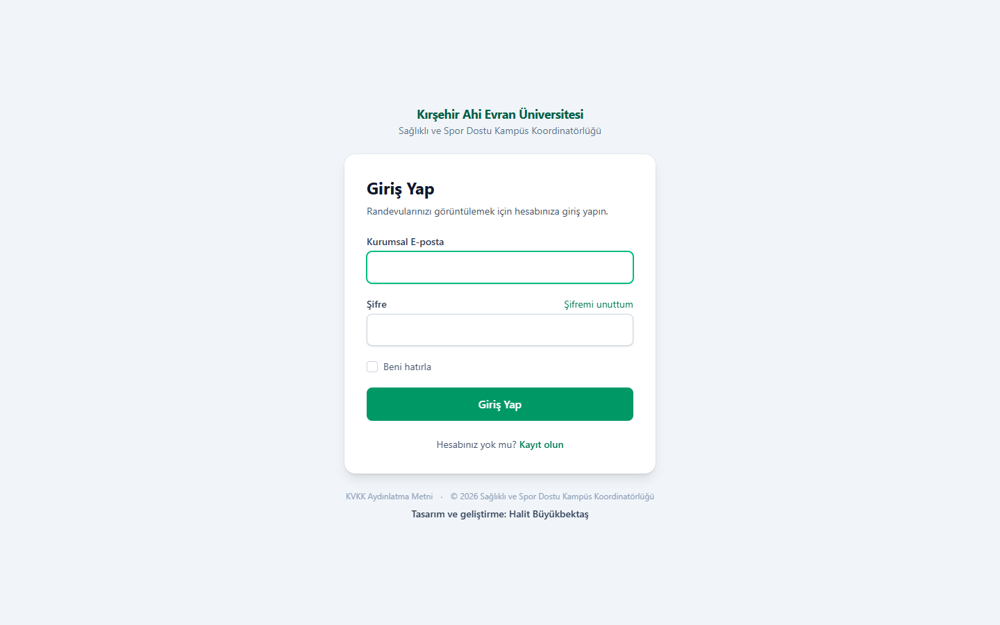
  &nbsp;
  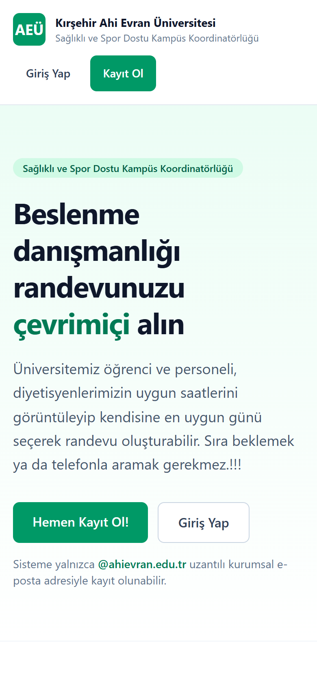

<b>Ana sayfanın tamamı</b>

 
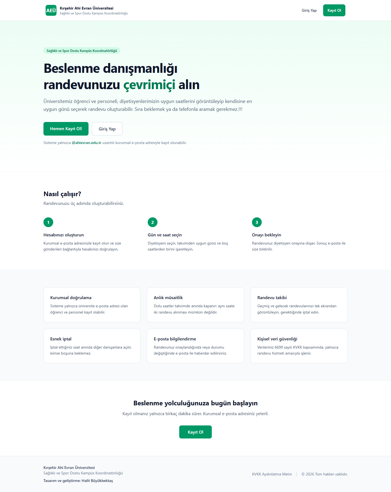

---

## 🏃 Spor Danışmanlığı Randevu Sistemi

**Sağlıklı ve Spor Dostu Kampüs Koordinatörlüğü** · 🔗 [spordanismanligi.ahievran.edu.tr](https://spordanismanligi.ahievran.edu.tr)

Öğrenciler danışman hocaların uygun saatlerini görüp kendi randevusunu alıyor; hoca da tüm programını
tek ekrandan yönetiyor. Ayrı bir kayıt formu yok: öğrenci üniversite e-postası ve şifresiyle giriyor,
şifreyi üniversitenin kimlik sistemi doğruluyor, sistem şifre saklamıyor.

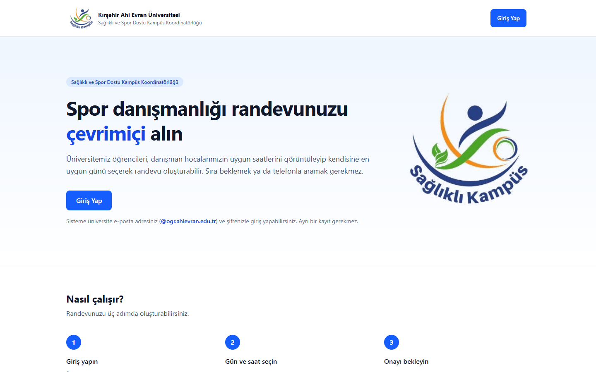

**Öğrenci tarafı**
- Üniversite hesabıyla tek adımda giriş
- Boş saatleri anlık gösteren takvim, randevu takibi ve iptal
- Randevu alındığında, onaylandığında ve iptal edildiğinde e-posta bildirimi

**Danışman hoca ve yönetici paneli**
- Müsaitlik takvimi, izin ve tatil yönetimi
- Randevu onay, ret ve katılım takibi
- Yönetici istatistikleri: kayıtlı öğrenci, randevu sayıları, gelmeme oranı, son 6 ayın grafiği

  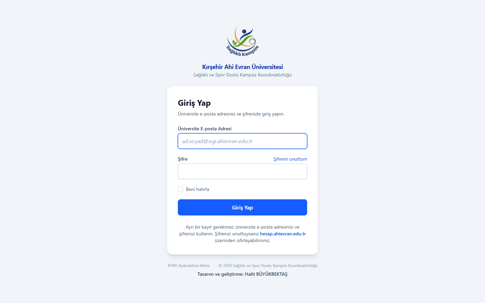
  &nbsp;
  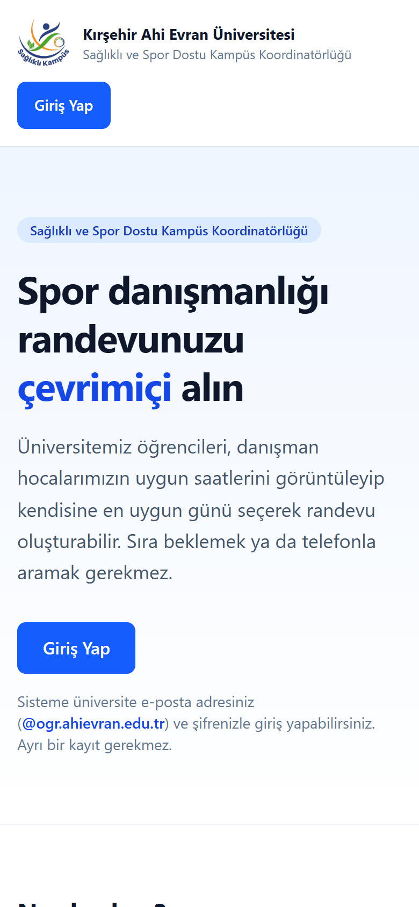

<b>Ana sayfanın tamamı</b>

 
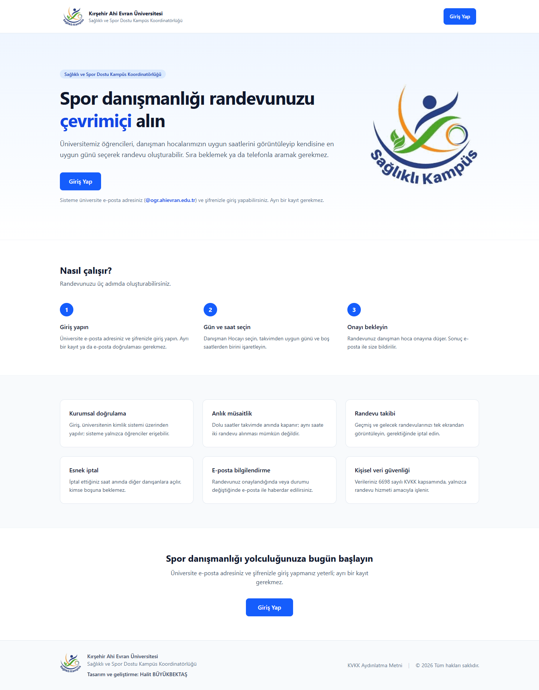

### İki randevu sisteminin ortak kuralları

| Kural | Açıklama |
|---|---|
| Randevu ufku | En fazla bir ay ilerisine randevu alınabilir |
| Kapalı günler | Hafta sonları ve resmî tatiller kapalı, arife günleri öğleden sonra kapanır |
| Aktif randevu sınırı | Bir kişinin aynı anda en fazla iki aktif randevusu olabilir |
| Gelmeme kuralı | Randevusuna gelmeyen kişi 14 gün yeni randevu alamaz |

| Rol | Yetki |
|---|---|
| Danışan / öğrenci | Randevu alır, randevularını görür ve iptal eder |
| Uzman (diyetisyen, danışman hoca) | Yalnızca kendi müsaitliğini ve randevularını yönetir |
| Yönetici | Kullanıcıları, uzmanları, müsaitliği ve tüm randevuları yönetir |

Her iki sistem de 6698 sayılı KVKK'ya uygun hazırlandı: veriler yalnızca randevu hizmeti için işlenir.

---

## 🐦 Kuş Gözlem Platformu

**Hirfanlı Baraj Gölü · Davulağıl Sosyal Tesisleri** · 🔗 [kusgozlem.ahievran.edu.tr](https://kusgozlem.ahievran.edu.tr)

*Gözlemle, Öğren, Koru.* Davulağıl'daki kuş gözlem kulesinde tür tabelaları var. Ziyaretçi tabeladaki
QR kodu okutunca o kuşun fotoğrafına, bilgisine ve sesine anında ulaşıyor; üniversite de içeriği
yazılımcıya ihtiyaç duymadan kendi panelinden güncelliyor.

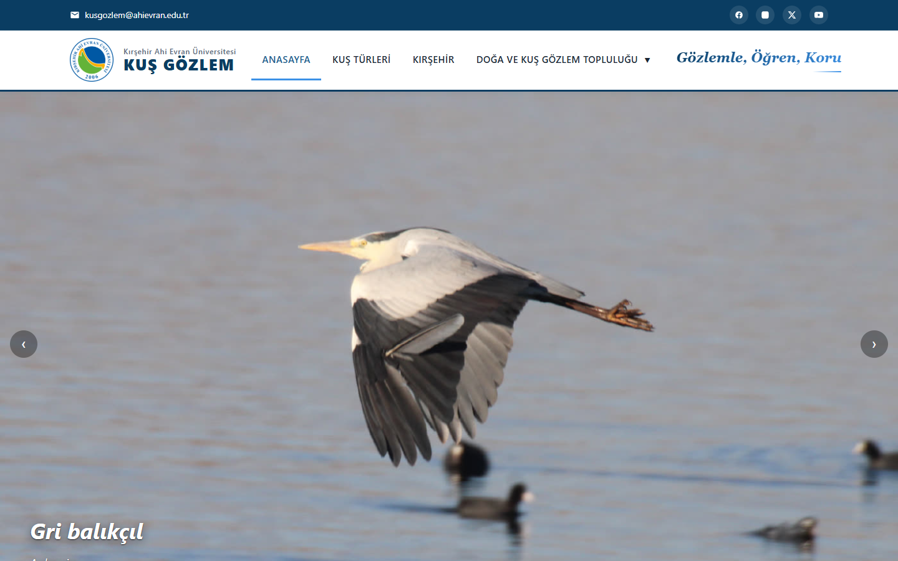

**Sitede**
- 20 kuş türü: flamingo, şah kartal, turna, ibibik, gri balıkçıl ve diğerleri
- Her tür için Türkçe ve Latince ad, fotoğraf, tanıtım metni, ses kaydı ve video
- Tanıtım metnini sesli okuyan **Metni Dinle** düğmesi
- Tabelaya basılan, okutulunca doğrudan türün sayfasını açan QR kodlar

**Yönetim panelinde**
- Kuş ekleme, düzenleme ve sıralama; fotoğraf, ses ve video yükleme
- Her tür için QR kod üretme ve indirme
- Slayt, galeri, sayfa ve menü yönetimi
- Yönetici, editör ve yazar rolleri

**Güvenlik**
- Şifreler bcrypt ile saklanır, oturumlar JWT ile yönetilir
- Giriş denemelerine hız sınırı, panel içeriğine zararlı koda karşı temizleme (DOMPurify)
- Yüklenen dosyaların türü ve boyutu denetlenir

  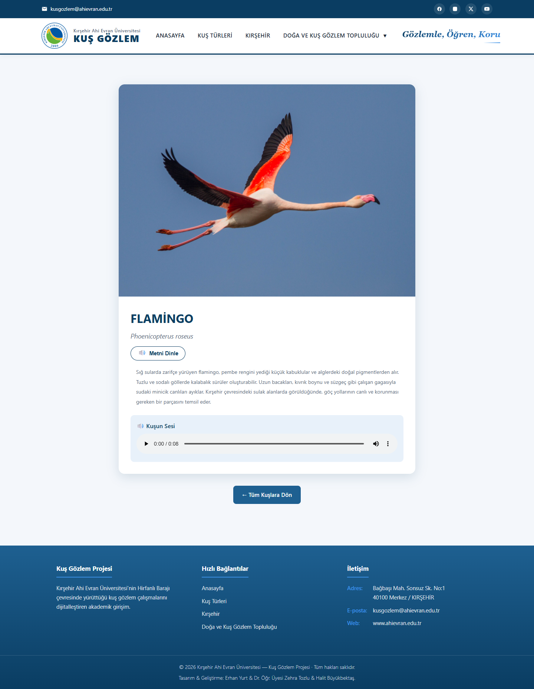
  &nbsp;
  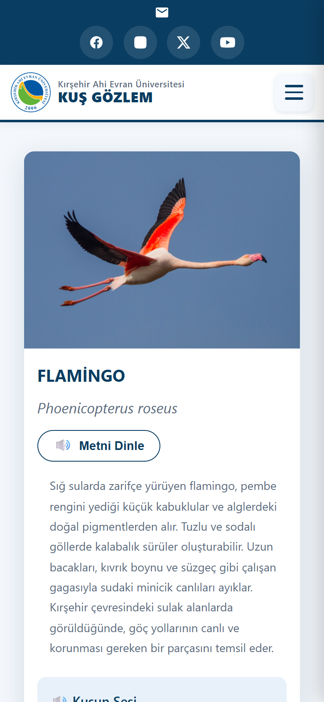

<b>Ana sayfanın tamamı</b>

 
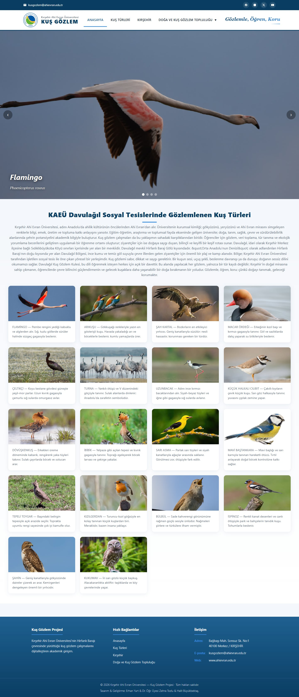

---

## Kullanılan teknolojiler

| Katman | Randevu sistemleri | Kuş Gözlem Platformu |
|---|---|---|
| Sunucu tarafı | PHP 8.3, Laravel 12 | Node.js, Express 5 |
| Yönetim paneli | Filament 3 | Projeye özel panel, CKEditor |
| Arayüz | Livewire 3, Tailwind CSS 4 | HTML, CSS, JavaScript |
| Veritabanı | MySQL | MySQL 8 |
| Test | PHPUnit | |
| Yayın ortamı | Üniversite sunucusu (Windows, Apache) | Üniversite sunucusu |

## Rolüm

Randevu sistemlerini veri modelinden yönetim paneline, kurum hesabıyla girişten testlere ve yayına
kadar tek başıma tasarlayıp geliştirdim. Kuş Gözlem Platformu'nda ekiple birlikte sitenin ve yönetim
panelinin tasarımında ve geliştirmesinde çalıştım, saha tabelaları için QR kodları ürettim.

## English summary

Three web systems I designed and built for Kırşehir Ahi Evran University, all live on university servers:
a **dietitian appointment system** and a **sports-counselling appointment system** (Laravel, Filament,
Livewire; institutional sign-in, availability calendars, booking rules, email notifications, KVKK
compliance) and the **Bird Watching Platform** (Node.js, Express, MySQL), which presents the bird species
of Lake Hirfanlı through QR-coded field signs. Source code is kept in private repositories because the
systems belong to the institution.

---

  <b>Halit Büyükbektaş</b> · Bilgisayar Mühendisliği, Kırşehir Ahi Evran Üniversitesi 
  <a href="https://github.com/halit-bbektas">GitHub</a> ·
  <a href="https://www.linkedin.com/in/halit-b%C3%BCy%C3%BCkbekta%C5%9F-632585353">LinkedIn</a> ·
  <a href="mailto:halitbektas1340@gmail.com">E-posta</a>

